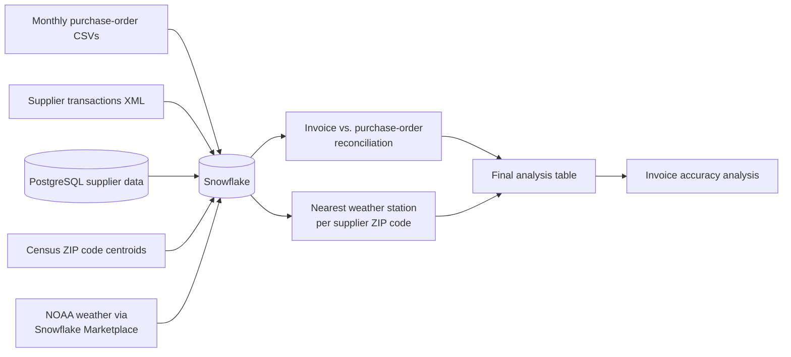

# Snowflake ETL Pipeline: Supplier Invoices, Purchase Orders & Weather

An end-to-end ETL pipeline built in **Snowflake** and **Python** that brings five separate data sources into one warehouse, then checks whether suppliers billed what they quoted.

**Author:** Rishabh Soni · [LinkedIn](https://linkedin.com/in/rishabhsoni10)

*Developed from a course project in the MS in Business Analytics program at UC San Diego's Rady School of Management (2024), then extended with corrected weather matching and an invoice-accuracy analysis.*

---

## Why it matters

Procurement teams need to know whether suppliers bill what was quoted. The data to answer that usually lives in different systems and formats. This project pulls it all into a single Snowflake schema, reconciles every invoice against its purchase order, and adds local weather for each supplier so invoice accuracy can be viewed alongside external conditions.

## Highlights

- **5 data sources** combined into one warehouse: CSV, XML, PostgreSQL, a Census file and Snowflake Marketplace data
- **Snowflake-native processing:** files are loaded with `COPY INTO`, with type conversion and XML parsing done inside Snowflake rather than in Python
- **2,400+ supplier transactions** shredded from XML and matched to purchase orders
- **Geospatial matching** of each supplier ZIP code to its nearest NOAA weather station using `ST_DISTANCE`
- **Data-quality fixes:** recovers 674 rows (8.1%) that a strict load silently drops, restores ZIP codes that lost their leading zero, and filters weather to true daily high temperatures
- **Credentials kept out of the code** with environment variables

## Pipeline

| Step | What happens | How |
|---|---|---|
| 1 | Load the 41 monthly purchase-order files | Snowflake stage, `PUT` and `COPY INTO` with fault-tolerant date conversion (`TRY_TO_DATE`, `NULL_IF`) |
| 2 | Calculate each order's received and ordered value | SQL aggregation of quantity × unit price |
| 3 | Load supplier transactions from XML | XML file format and `COPY INTO` with `XMLGET` |
| 4–5 | Match invoices to purchase orders and compare amounts | Join on supplier and purchase order, materialized view |
| 6 | Bring in supplier details from PostgreSQL | PostgreSQL `COPY TO` via `psycopg2`, auto-generated table schema, Snowflake load |
| 7 | Find each supplier's nearest weather station and daily high temperature | Census ZIP centroids, `ST_DISTANCE`, `QUALIFY ROW_NUMBER()` |
| 8 | Build the final table, one row per invoice | Joins on supplier, ZIP code and transaction date |
| 9 | Analyse invoice accuracy by supplier and by temperature | pandas, matplotlib |

## Results

Reconciling 2,072 supplier invoices against purchase orders worth about $941M (January 2019 – May 2022):

- **99.8% of invoices** matched the value of goods received to the cent.
- **5 invoices from one supplier** (Fabrikam, Inc., orders placed June–July 2021) were billed for the full ordered quantity even though only 35–75% of the goods had been received, a total of **about $2.87M billed above the value received**.
- **All 5 exceptions** fall in months with corrupted timestamps. A strict load drops those rows without warning and reports zero discrepancies, so the data-quality fix is what surfaces them.

## Tech stack

**Snowflake** (stages, COPY INTO, XML parsing, materialized views, geospatial functions, Marketplace data) · **Python** (psycopg2, pandas, matplotlib) · **PostgreSQL** · **SQL**

## Files

- `supplier_pipeline.ipynb`: the full pipeline and analysis
- `.env.example`: template for the Snowflake and PostgreSQL credentials the notebook reads
- `.gitignore`: keeps credentials and generated files out of the repo
